<div align="center">


**Machine Learning Engineer · Statistician · Researcher in Item Response Theory & ML evaluation**
<br/>
Brazil 🇧🇷

[](https://manuelfjr.github.io)
[](https://www.linkedin.com/in/manuefjr)
[](mailto:ferreira.jr.ufpb@gmail.com)
[](https://www.instagram.com/manuelferreirajr/)


</div>

---

## 🧭 About me

```python
class Manuel:
    name      = "Manuel Ferreira-Junior"
    role      = "Machine Learning Engineer @ Kunumi"
    education = {
        "B.Sc. Statistics":        "UFPB",
        "M.Sc. Computer Science":  "CIn-UFPE (in progress)",
    }
    research  = ["Item Response Theory", "ML evaluation", "Clustering evaluation",
                 "Probabilistic modeling", "LLM evaluation", "Trustworthy AI"]
    languages = ["Python", "R", "SQL"]

    def motto(self):
        return "Rigorous statistics, shipped as real products."
```

- 🔬 I study **how to evaluate models beyond a single accuracy number**: which instances are hard, which models are truly able, and why.
- 🏗️ At **Kunumi** I build end-to-end ML solutions: data pipelines, explainable models and cloud workflows (Azure, Databricks, Spark).
- 📦 I maintain **[birt-gd](https://pypi.org/project/birt-gd/)**, a Python package for fitting β³-IRT models with gradient descent.
- ☕ Fueled by coffee, curiosity and well-calibrated confidence intervals.

---

## 📚 Research & publications

| | Work | Venue |
|:-:|:--|:--|
| 🧩 | **CLAIRE: clustering evaluation based on item response theory and model agreement**<br/><sub>Ferreira-Junior, Lima Neto, Ferreira, Silva Filho, Prudêncio</sub> | [](https://doi.org/10.1007/s10994-025-06911-0) |
| 📈 | **β⁴-IRT: A New β³-IRT with Enhanced Discrimination Estimation**<br/><sub>Ferreira-Junior, Reinaldo, Silva Filho, Lima Neto, Prudêncio</sub> | [](https://arxiv.org/abs/2303.17731) |
| 📉 | **Evaluating regression algorithms at the instance level using item response theory**<br/><sub>Moraes, Reinaldo, Ferreira-Junior, Silva Filho, Prudêncio</sub> | [](https://doi.org/10.1016/j.knosys.2021.108076) |
| 🌸 | **Iris-CV: Classifying Iris Flowers Is Not as Easy as You Thought**<br/><sub>Rocha Filho et al.</sub> | [](https://link.springer.com/chapter/10.1007/978-3-030-91699-2_18) |

<sub>Full list on <a href="https://manuelfjr.github.io/publications/">manuelfjr.github.io/publications</a>.</sub>

### 🎤 Talks & tutorials

| | Tutorial | Where |
|:-:|:--|:--|
| 🇬🇧 | **Latent Ability: latent-ability-aware evaluation in machine learning**<br/><sub>3-hour hands-on workshop: binary IRT and 2PL → β⁴-IRT → CLAIRE. With Prof. Ricardo Prudêncio.</sub> | [](https://manuelfjr.github.io/latent-ability-ml/) |
| 🇧🇷 | **Quão difícil é cada exemplo? Model evaluation with Item Response Theory**<br/><sub>60-minute tutorial (20 min talk + 40 min hands-on in the browser), Advanced Summer School on Responsible AutoML, Nov 2026.</sub> | [](https://manuelfjr.github.io/latent-ability-ml/ita/) |

---

## 🚀 Featured projects

<table>
<tr>
<td width="50%" valign="top">

### 📦 birt-gd
Gradient-descent implementation of **β³-IRT** for fitting item response models at scale.

[](https://pypi.org/project/birt-gd/)
[](https://pepy.tech/project/birt-gd)

</td>
<td width="50%" valign="top">

### 🗄️ ResponseDB
A database of model response patterns that supports **IRT model development** and reproducible experiments.

[](https://responsedb.github.io/)

</td>
</tr>
<tr>
<td width="50%" valign="top">

### 🧩 CLAIRE
Evaluates clustering models through **model agreement + IRT**, estimating model ability and instance difficulty without labels.

[](https://doi.org/10.1007/s10994-025-06911-0)
[](https://github.com/Manuelfjr/claire)

</td>
<td width="50%" valign="top">

### 🎓 Latent Ability
Interactive **IRT tutorial platform**: notebooks that run in the browser, activities and answer keys. Used at **Bristol** and **ITA**.

[](https://manuelfjr.github.io/latent-ability-ml/)
[](https://manuelfjr.github.io/latent-ability-ml/ita/)

</td>
</tr>
</table>

---

## 💼 Experience

```text
2022 ── now   Machine Learning Engineer · Kunumi
               ETL, explainable ML, cloud workflows (Azure Data Lake, Databricks, Spark)

2022 ── 2022  Jr. Data Scientist · Sem Processo
               Survival-analysis risk models, regression/classification/NLP, forecasting, dashboards

2021 ── 2022  Data Scientist Intern · Sem Processo
               Predictive modeling and statistical studies

2021 ── 2022  Data Scientist Intern · Apps de Bolso
               Deep learning recommender that suggests exam questions from student performance
```

---

## 🛠️ Tech stack

<div align="center">


<br/>


</div>

---

## 📊 GitHub stats

<div align="center">





</div>

<div align="center">
  <picture>
    <source media="(prefers-color-scheme: dark)" srcset="https://raw.githubusercontent.com/Manuelfjr/Manuelfjr/output/github-contribution-grid-snake-dark.svg" />
    <source media="(prefers-color-scheme: light)" srcset="https://raw.githubusercontent.com/Manuelfjr/Manuelfjr/output/github-contribution-grid-snake.svg" />
    
  </picture>
</div>

---

<div align="center">

### 🤝 Let's connect

Always happy to talk about **machine learning, statistics, IRT and research-driven products**.<br/>
Reach out on [LinkedIn](https://www.linkedin.com/in/manuefjr), by [email](mailto:ferreira.jr.ufpb@gmail.com), or visit [my website](https://manuelfjr.github.io).

<sub>Citation name: <b>Ferreira-Junior, M.</b></sub>

</div>
